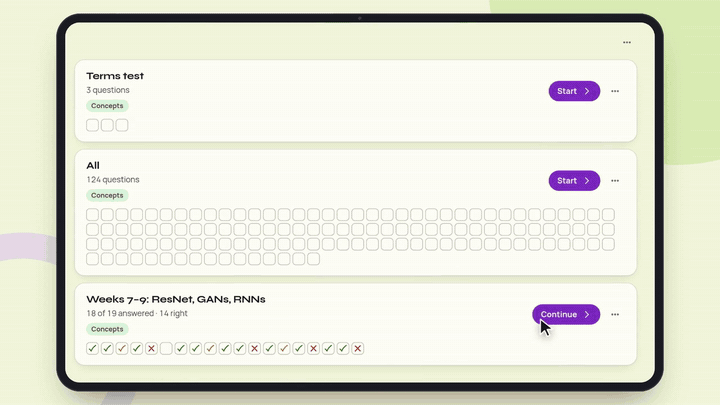
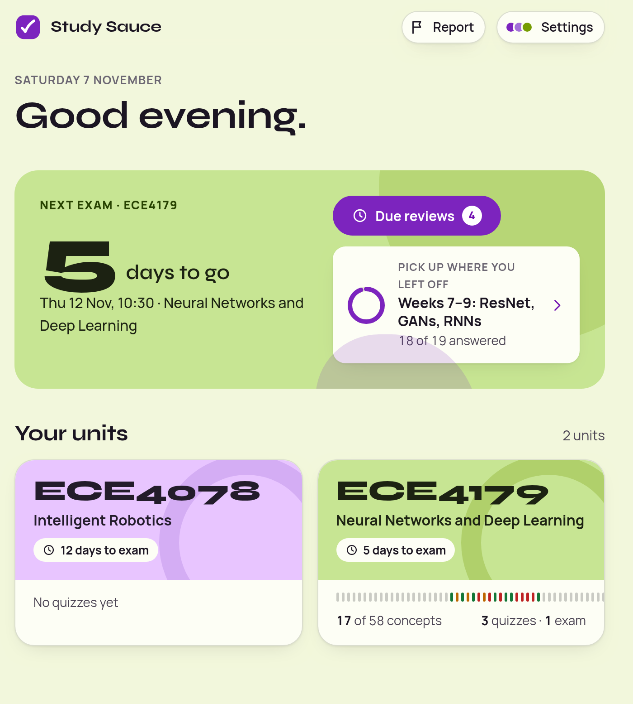
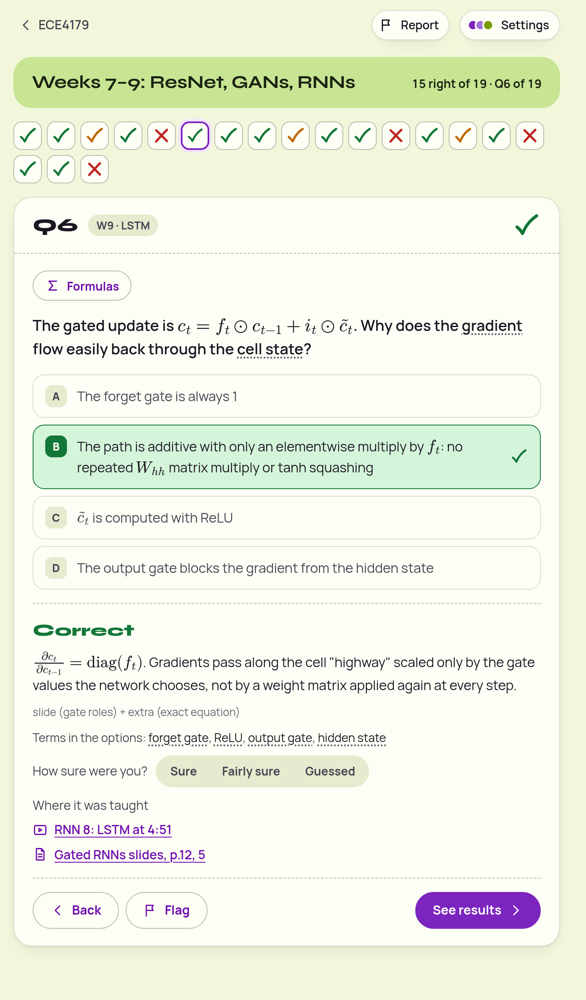
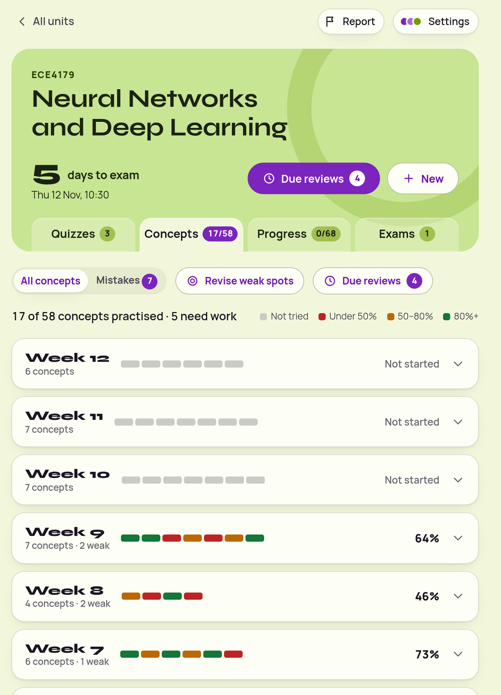

# ma-study

Exam-study skills for Monash students, shared within Monash Automation. Made by Sam Roberts with Claude.

- **ma-study-notes** reads a unit's Moodle page, the slides and worksheets on Google Drive, and Ed threads, then writes one notes file per week.
- **ma-study-quiz** quizzes you on those notes in an interactive Study Hub, with rendered maths, links back to the lecture video and slide, spaced repetition and weak-spot revision.

In the Study Hub you can also make new quizzes and practice exams, ask Claude about any question, and report a problem with one button.

▶️ [Watch the launch video](docs/ma-study-launch.mp4) (97 s, with sound)

| Every answer explains itself and links to the lecture moment and slide | Progress by week and concept shows what needs work |
|---|---|
|  |  |

## Install

1. Get the [Claude desktop app](https://claude.ai/download) and open the **Code** tab. (The Chat tab can't open Moodle or save notes.)
2. When it asks for a folder, make a folder called `University` in your home folder and choose it.
3. Type: *"Install the ma-study plugin from github.com/samsamthecodingman/ma-study."* Then start a new session.
   (Or type this yourself: `/plugin install ma-study --marketplace samsamthecodingman/ma-study`)
4. In **Settings → Connectors**, add **Google Drive** and sign in with your Monash Google account.
5. Optional: turn on automatic updates. Type `/plugin`, go to **Marketplaces** → **monash-automation**, and choose **Enable auto-update**.

## Updating

When a new version is out, Claude tells you at the start of a quiz session and your Study Hub shows a notice. To update, type `/plugin`, choose **ma-study**, then **Update now**, and start a new session. (With auto-update on, this happens by itself.)

Your Study Hub updates itself the next time Claude quizzes you, or ask Claude to "update my Study Hub". Your progress stays.

Installed before 1.1.1? Update once by hand as above. Older versions can't tell you about new ones.

See what changed in [Releases](https://github.com/samsamthecodingman/ma-study/releases).

## Use

Type `/ma-study`, or just say *"help me study for ECE4179"*. Claude opens Moodle for you to sign in, asks a couple of letter-answer questions, and builds the notes. Then say *"quiz me on weeks 7–9"*.

You'll see approval prompts while it works. Read each one before approving. They should only be about reading Moodle, Drive and Ed, and saving notes into your `University` folder. If one asks for anything else, say no. Avoid "always allow" for commands.

Only install the plugin from this repo or a link a teammate sent you. It changes what Claude does on your computer.

Course slides are sent to Claude to build your notes, and the quiz page is published to your private claude.ai Artifacts. Check Monash's rules on using AI tools with unit material before you share the page or the notes.

Building a whole unit uses a fair share of your Claude usage. If it stops partway, ask again and it carries on from where it stopped.

**Tip:** pin your Study Hub so it's always in your Claude sidebar. Ask Claude to "pin my Study Hub".

## Without Claude (Codex or another agent)

You don't need Claude to use a Study Hub.

1. Get the standalone Study Hub file from a friend who has Claude. They ask Claude to *"export my Study Hub for sharing"*.
2. Open the file in a browser. Your progress saves in that browser, so keep using the same one.
3. To make more quizzes, use [Codex CLI](https://github.com/openai/codex) or another coding agent. Copy or symlink `skills/ma-study-notes` and `skills/ma-study-pack` into `~/.codex/skills`. Or just open this repo folder in the agent, and it reads `AGENTS.md`.
4. Ask it: *"make a quiz pack for ECE4179 weeks 11–12"*. It needs your notes first (see ma-study-notes), and it saves a `.json` file in `~/University/ECE4179/packs/`.
5. In your Study Hub, go to **Settings → Features → Quiz packs → Import** and pick that file.

## Report a problem

Use the **Report** button at the top of the Study Hub. Claude checks with you in chat before posting it as an issue here, then replies on the issue with a plan to fix it. This repo is public, so leave out personal details.
